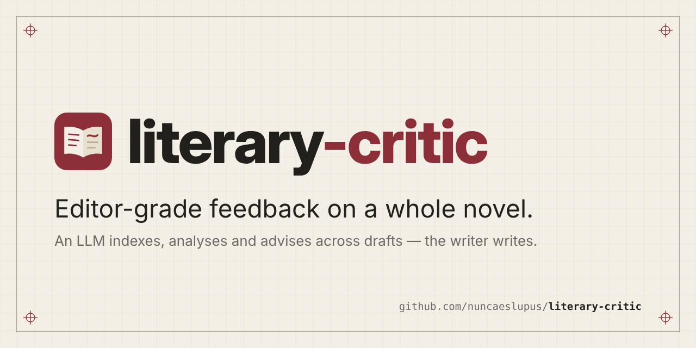

# literary-critic

<p align="center">
  
</p>

Tooling that lets an LLM work through a full novel manuscript as a professional
editor would — and that keeps working across many chat sessions and drafts.

1. **Index** — turn the manuscript into stable anchors (part → chapter → scene →
   paragraph) and a Codex — a knowledge base of scenes, characters, places,
   facts, setups/payoffs and findings, each tied to its text — so the LLM can
   find and relate anything without loading the whole book.
2. **Analyse** — run a generic catalogue of checks (structure, characters, plot,
   scenes, POV, prose, dialogue, continuity, …), adapted to each novel, with
   evidence anchored to the text and script-measured metrics wherever possible.
3. **Advise** — produce prioritised, concrete revision actions in rounds
   (structural first, then scene, then line level), track their status, re-index
   the next draft and measure what changed.

For novelists, and the editors who work with them, who want an LLM's reading of
a whole manuscript without handing it the pen. In Claude Code:

```bash
git clone https://github.com/nuncaeslupus/literary-critic.git && cd literary-critic && claude
# then say: "I want to use literary-critic for my novel"
```

Status: early development. See `status/specification.md` and `status/plan.md`.

Documents are read and written through
[doc-control](https://github.com/nuncaeslupus/doc-control), which owns the generic
document work (paragraph addresses, chapters and scenes, diff, locating,
tracked-change edits, comments, undo). literary-critic owns the literary side: the
index, the Codex, the checks, letters and revision rounds. See
[`docs/architecture.md`](docs/architecture.md).

## How it is used

| Where | How |
|-------|-----|
| Claude Code (local or cloud) | Clone, open, talk. Scripts run directly. |
| Claude (desktop app with Cowork, or Claude.ai) | Add the literary-critic Skill once (`lc kit --skill` builds the zip to upload in Claude's settings, under Skills), then say "I want to use literary-critic for my novel". |
| Chat with code execution (ChatGPT, Claude.ai, Gemini) | Upload the kit zip (`lc kit` builds it; the assistant reads its `START_HERE.md`) and your workspace zip; the assistant runs the scripts and returns an updated workspace zip. |
| Chat without code execution | Paste the portable prompts from `prompts/`; reduced mode without metrics. |

Your novel and all working files live in a **workspace folder outside this
repo** — a Google Drive folder works well. See `docs/workspace.md`.

## Development

```bash
uv sync          # Python >= 3.11; runtime is the standard library plus doc-control
make ci          # lint, typecheck, tests, content guard
```

Rules for contributors and assistants: [`AGENTS.md`](AGENTS.md).

## Related projects

Built with [claude-arsenal](https://github.com/nuncaeslupus/claude-arsenal), the
spec-driven Claude Code workflow and gated task queue this repo is developed on.
Same author:

- [claude-arsenal](https://github.com/nuncaeslupus/claude-arsenal) — a Claude Code skill and plugin marketplace: specs before code, failing tests first, gates with numbers.
- [doc-control](https://github.com/nuncaeslupus/doc-control) — a deterministic tool for AI agents to read and edit Word documents as tracked changes; literary-critic's document layer.
- [drawspec](https://github.com/nuncaeslupus/drawspec) — declarative diagram spec → clean, themeable SVG; JSON with no coordinates, so an LLM can write it.
- [integral-job-search](https://github.com/nuncaeslupus/integral-job-search) — a candidate-centred job search run as a conversation in Claude Code.

## License

Apache License 2.0 — see `LICENSE` and `NOTICE`.
